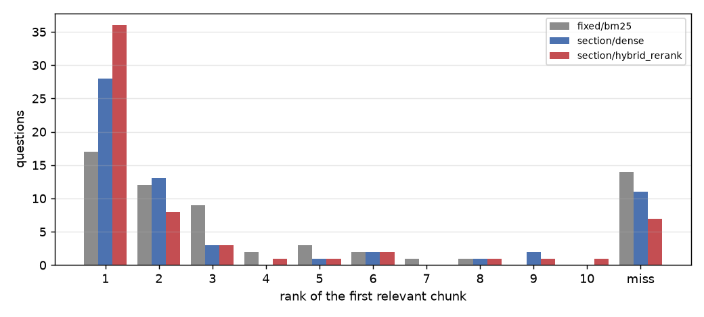

<div align="center">

# 🤖 Ask the ROS 2 docs: a RAG pipeline you can measure

**Retrieval-augmented question answering over the ROS 2 documentation and three ROS 2 papers: RST/PDF ingestion → three chunking strategies → BM25 + dense hybrid search in Chroma → cross-encoder reranking → Claude answers with numbered citations. Every retrieval choice is scored on a hand-built, corpus-verified question set with Hit@k, MRR, nDCG and paired bootstrap tests.**

[](https://github.com/haroonkhan02/robotics-docs-rag/actions/workflows/ci.yml)


<sub>61 questions, 3 chunking strategies × 4 retrieval modes. Error bars are 95 % bootstrap intervals over questions.</sub>

</div>

---

## Highlights

- **A full RAG stack built from parts I can explain**: my own reStructuredText parser (keeps heading paths and code blocks, drops images/toctrees), PDF page extraction, three chunkers, BM25 (`rank-bm25`) + BGE-small embeddings in a persistent **Chroma** collection, **reciprocal-rank fusion**, a **MS-MARCO cross-encoder** reranker, and **Claude Opus 5.5** answering only from numbered passages, with `[n]` citations that link back to the docs URL or PDF page.
- **An evaluation set that doesn't depend on chunking**: 61 hand-written questions (CLI, concepts, how-to, project, PDF papers) plus 5 unanswerable ones. A chunk counts as relevant if it comes from a gold document **and** contains an answer phrase, so fixed, recursive and section chunks are scored on equal terms. `rag-check-eval` proves every answer phrase exists in the parsed corpus.
- **Measured, not assumed**: the best configuration (section chunks with heading prefixes, hybrid search and reranking) reaches **MRR@10 0.690** and **Hit@1 0.590**, against 0.454 / 0.279 for the fixed-window BM25 baseline. Paired bootstrap tests show which differences are real at n = 61 and which are noise (most ablations are noise).
- **Honest failure analysis**: in the misses, the solution sits in the chunk *after* the problem statement, a number is buried in a flattened PDF table, a one-sentence answer loses to pages with the question's vocabulary, or an overview page outranks the how-to it links to. None of these is a labelling error.
- **Answer-quality harness ready**: `rag-eval-answers` uses Claude as a judge with **structured JSON output** to split each answer into claims and checks them against the cited passages and the whole context. It reports faithfulness, citation accuracy, correctness against the reference answer and abstention on unanswerable questions. *It was not run here: no API key was available on this machine (see [Results](#results)).*
- **Product shape**: FastAPI backend (`/search`, `/ask`, `/health`) with a one-page chat UI, a CLI, a Dockerfile built in CI, and 47 unit tests (hashing embedder, fake reranker, mocked Claude client) that run in CI on Python 3.10–3.12 without PyTorch, models, data or a key.

## Pipeline

```mermaid
flowchart LR
    A[ROS 2 docs .rst<br/>296 pages, CC BY 4.0] --> C[ingest<br/>RST parser · heading paths]
    B[3 arXiv PDFs] --> C2[ingest<br/>pypdf · per page]
    C --> D{chunking}
    C2 --> D
    D -->|fixed / recursive / section| E[BGE-small embeddings<br/>MPS → Chroma HNSW]
    D --> F[BM25 index]
    Q[question] --> F
    Q --> E
    F --> G[RRF fusion<br/>top 30 + top 30]
    E --> G
    G --> H[cross-encoder rerank<br/>ms-marco-MiniLM-L-6]
    H -->|top 5 numbered passages| I[Claude Opus 5.5<br/>cite every sentence or abstain]
    I --> J[answer + citations<br/>FastAPI · chat UI · CLI]
    H -.-> K[(rag-eval-retrieval<br/>Hit@k · MRR · nDCG)]
    I -.-> L[(rag-eval-answers<br/>LLM judge: faithfulness, citations)]
```

## Results

All retrieval numbers come from `rag-eval-retrieval` and `scripts/run_ablations.sh`, run on an Apple M5 (embeddings on MPS) against ros2_documentation at commit `0ea463a2` (branch jazzy) plus the three papers. That is 299 documents and 311,583 words. Raw per-question results are in `reports/retrieval/results_*.json`.

### 1 · Chunking × retrieval grid (61 answerable questions)

| Chunking | Retrieval | Hit@1 | Hit@3 | Hit@5 | Hit@10 | MRR@10 | nDCG@10 | ms/query |
|---|---|---|---|---|---|---|---|---|
| fixed (180 w, 40 overlap) | BM25 | 0.279 | 0.623 | 0.705 | 0.770 | 0.454 | 0.489 | 1 |
| fixed | dense | 0.311 | 0.705 | 0.803 | 0.885 | 0.511 | 0.544 | 9 |
| fixed | hybrid (RRF) | 0.393 | 0.721 | 0.803 | **0.902** | 0.572 | 0.607 | 7 |
| fixed | hybrid + rerank | 0.426 | 0.721 | 0.803 | 0.885 | 0.579 | 0.590 | 176 |
| recursive (≤180 w) | BM25 | 0.328 | 0.607 | 0.656 | 0.787 | 0.480 | 0.504 | 1 |
| recursive | dense | 0.377 | 0.639 | 0.770 | 0.820 | 0.523 | 0.551 | 6 |
| recursive | hybrid (RRF) | 0.377 | 0.623 | 0.770 | 0.869 | 0.535 | 0.582 | 7 |
| recursive | hybrid + rerank | 0.410 | 0.689 | 0.787 | 0.852 | 0.557 | 0.591 | 168 |
| section + heading prefix | BM25 | 0.377 | 0.607 | 0.721 | 0.787 | 0.506 | 0.517 | 1 |
| section + heading prefix | dense | 0.459 | 0.721 | 0.738 | 0.820 | 0.596 | 0.603 | 6 |
| section + heading prefix | hybrid (RRF) | 0.426 | 0.705 | 0.787 | **0.902** | 0.574 | 0.609 | 8 |
| **section + heading prefix** | **hybrid + rerank (default)** | **0.590** | **0.770** | **0.803** | 0.885 | **0.690** | **0.692** | 159 |

<sub>Hit@k = share of questions with at least one relevant chunk in the top k. MRR@10 = mean of 1/rank of the first relevant chunk. Latency is retrieval only (no LLM), mean per query on the M5 after a warm-up query; the reranker scores 30 candidates. Index build: 17–20 s of embedding per strategy (2,080–3,680 chunks).</sub>

**What the numbers say**

- **The reranker is what puts the right passage first.** On section chunks it lifts Hit@1 from 0.426 (hybrid) to 0.590 and MRR from 0.574 to 0.690 (paired bootstrap p = 0.02). Hit@5 hardly moves (0.787 → 0.803). The candidates were already in the list; the reranker reorders them. That matters because the LLM reads passages in order and a 5-passage budget is small.
- **Section-aware chunking only pays off together with the reranker.** With reranking, section chunks beat fixed windows by 0.111 MRR (p = 0.007) and recursive packing by 0.133 (p = 0.005). Without it, no chunker difference is significant (the closest is dense section vs fixed, +0.085 MRR, p = 0.06). Every heading-prefixed chunk says what it is about ("Understanding topics > Tasks > 8 ros2 topic hz"), and a cross-encoder can use that.
- **Hybrid helps BM25 more than it helps dense.** BM25 alone misses paraphrases ("how fast messages are arriving" vs `ros2 topic hz`). Dense alone sometimes misses exact identifiers. RRF never did worse than BM25, but on section chunks plain RRF (0.574) did not beat dense (0.596). Fusing with a weak list can push good results down, and the reranker repairs that.
- **Recall ceiling**: even the best setup misses 7 of 61 questions in the top 10 (Hit@10 0.885). See [Failure analysis](#failure-analysis).

<p align="center"></p>

### 2 · Ablations (section chunking, all four retrieval modes)

| Variant | Dense MRR@10 | Hybrid + rerank MRR@10 | p vs default (rerank) |
|---|---|---|---|
| **Default: BGE-small, 180 words, heading prefix** | 0.596 | **0.690** | — |
| MiniLM-L6 embeddings instead of BGE-small | 0.417 (p = 0.001) | 0.711 | 0.11 |
| 100-word chunks | 0.553 | 0.696 | 0.85 |
| 300-word chunks | 0.635 | 0.714 | 0.38 |
| No heading prefix | 0.533 (p = 0.08) | 0.639 | 0.19 |

<p align="center"></p>

- **The embedding model matters a lot for dense-only search** (BGE-small beats MiniLM by 0.18 MRR, p = 0.001). With the reranker on top the gap disappears: the cross-encoder makes the final decision, and the bi-encoder only needs to get the answer into the top 30.
- **The heading prefix is the most useful single trick** (+0.05 to +0.06 MRR in dense and reranked modes), but with 61 questions it is not significant (p = 0.08 / 0.19). It is directionally consistent; more questions would settle it.
- **Chunk size (100 / 180 / 300 words) made no detectable difference.** The default stayed at 180 words. It was fixed before any evaluation, and switching to 300 because it scored 0.024 higher *on the test questions* would be tuning on the test set.

Full table with every mode and CIs: [`reports/retrieval/ablations.md`](reports/retrieval/ablations.md).

### 3 · Answer quality (LLM-judged): not measured yet

`rag-eval-answers` (generation with `claude-opus-5-5` at `effort: low`, judge with structured outputs) is implemented and unit-tested with a mocked client. **No `ANTHROPIC_API_KEY` was available when this was built, so no answer-level number is reported here.** To produce them (about 132 API calls for 66 questions):

```bash
cp .env.example .env   # put your key in .env (git-ignored)
rag-eval-answers       # → reports/answers/results.json: faithfulness, citation accuracy, correctness, abstention
```

### Failure analysis

I read the top chunks for every question the default setup misses in its top 3 (14 questions; see `per_question` in `results_main.json`). The labels were not edited after the run. Typical patterns:

| Pattern | Example | Why it fails |
|---|---|---|
| Problem and solution in neighbouring chunks | "Large messages over WiFi stall; which kernel setting helps?" | The top chunk describes the IP-fragment problem. The fix (`net.ipv4.ipfrag_time`) starts the next paragraph, which lands in the next chunk with a weaker match. |
| Number buried in a flattened PDF | "How far did the robots drive in the marathon?" | 37.4 miles appears once in the abstract (page 1) and once in a results table that `pypdf` flattens into a row of numbers (page 6). The retrieved chunks are page-6 prose about the 300 m route, which matches the question's wording better. |
| Vocabulary gap the reranker can't bridge | "What replaces ROS 1 latched topics?" | The answer is one sentence in the QoS page ("similar to that of latching publishers"). The top results are about the ROS 1 bridge and topics in general. |
| Overview outranks the how-to it links to | "How do I switch to a different DDS vendor at run time?" | The DDS-implementations overview ends with "you can change the vendor used at runtime: Working with Multiple RMW Implementations". It wins, but the `RMW_IMPLEMENTATION` answer is on the linked page. |

These suggest the next fixes: parent-document retrieval (return the neighbouring chunk too), table-aware PDF parsing, and query rewriting with Claude. See [Future work](#future-work).

## Repository structure

```text
robotics-docs-rag/
├── configs/default.yaml          # every pipeline knob, commented
├── eval/questions.jsonl          # 61 answerable + 5 unanswerable questions, gold docs, answer keys
├── src/roborag/
│   ├── download.py               # rag-download: ROS 2 docs @ pinned commit (zip) + 3 arXiv PDFs
│   ├── ingest.py                 # RST parser (headings, directives, inline roles) + PDF pages
│   ├── chunking.py               # fixed / recursive / section(+heading prefix) chunkers
│   ├── models.py                 # bi-encoder and cross-encoder wrappers (MPS → CPU)
│   ├── store.py                  # Chroma persistent collection (cosine HNSW) + chunk JSONL
│   ├── retrieval.py              # BM25, dense, reciprocal-rank fusion, reranking
│   ├── index.py                  # rag-index: corpus → chunks → embeddings → Chroma
│   ├── generate.py               # Claude prompt, citations, abstention, refusal fallback, no-key mode
│   ├── ask.py                    # rag-ask CLI
│   ├── api.py, static/       # rag-serve: FastAPI + one-page chat UI
│   ├── evalset.py                # rag-check-eval: chunking-independent relevance + grounding check
│   ├── metrics.py                # Hit@k, MRR, nDCG, P@k, bootstrap CIs, paired tests, citation parser
│   ├── evaluate_retrieval.py     # rag-eval-retrieval: strategy × mode grid
│   ├── evaluate_answers.py       # rag-eval-answers: Claude-as-judge with structured JSON output
│   ├── ablations.py, plots.py    # summary table and figures
├── scripts/run_ablations.sh      # embedding / chunk-size / heading-prefix ablations
├── reports/retrieval/            # results_*.json, tables, figures (generated)
├── tests/                        # 47 tests: synthetic corpus, hashing embedder, mocked Claude
├── Dockerfile, docker/entrypoint.sh
└── .github/workflows/ci.yml      # lint + tests on 3.10–3.12, then docker build
```

## Getting started

```bash
git clone https://github.com/haroonkhan02/robotics-docs-rag.git && cd robotics-docs-rag
uv venv --python 3.12 && source .venv/bin/activate
uv pip install -e ".[dev]"

rag-download                  # ROS 2 docs (5 MB of .rst) + 3 papers (25 MB) into data/
rag-index --strategy all      # ~1 min on an M5: 3 chunkings, embeddings, Chroma in models/index
rag-check-eval                # every eval answer phrase is present in the parsed corpus
rag-eval-retrieval            # the grid above → reports/retrieval/
./scripts/run_ablations.sh && python -m roborag.ablations

cp .env.example .env          # add ANTHROPIC_API_KEY (optional; without it you get passages only)
rag-ask "How do I make late-joining subscribers receive the last message?"
rag-serve                     # http://127.0.0.1:8000 chat UI, /docs for the API
```

Docker (CPU; builds the index on first start into named volumes):

```bash
docker build -t robotics-docs-rag .
docker run -p 8000:8000 --env-file .env -v rag-data:/app/data -v rag-models:/app/models robotics-docs-rag
```

<p align="center"></p>
<p align="center"><sub>The chat UI running locally without a key: it falls back to showing the ranked passages with their section paths. With a key, the answer appears above them with clickable [n] citations.</sub></p>

## Design decisions

| Decision | Why |
|---|---|
| ROS 2 docs (jazzy) at a **pinned commit** | Open licence (CC BY 4.0), real engineering text with commands, code and cross-links. Pinning makes the eval reproducible: answer phrases are verified against that exact snapshot. |
| Exclude the auto-generated `*Complete-Changelog*` pages | 6 pages, 144k words of raw package-name lists that match almost every identifier query and answer none. |
| Own RST parser instead of docutils/Sphinx | Sphinx needs the full doc build and its extensions. A small parser (about 200 lines including PDFs) keeps heading paths, code blocks and admonitions, and is unit-tested. |
| **Answer-key relevance** instead of chunk-ID labels | Chunk IDs change with every chunking. "Gold document + answer phrase present" scores fixed, recursive and section chunks identically, which is the whole point of comparing them. |
| Hand-written questions, not LLM-generated | Questions generated from a chunk tend to reuse its words, which flatters BM25 and that exact chunk. I paraphrased on purpose ("how fast messages arrive" vs `ros2 topic hz`). |
| BGE-small-en-v1.5 (33 M params) | Small enough to embed 3,680 chunks in ~20 s on MPS. Uses an instruction prefix on the query side only, as trained. |
| RRF (k = 60) instead of score blending | BM25 scores are unbounded and cosine is in [−1, 1]. Ranks need no calibration, and k = 60 is the standard constant from Cormack et al. (2009). |
| Cross-encoder on 30 fused candidates | The measured cost is ~160 ms per query on the M5, against a Claude call that takes seconds. It is the biggest single gain in the table. |
| Claude Opus 5.5, `effort: low`, server-side refusal fallback | Grounded Q&A over 5 short passages is not a hard reasoning task, so low effort keeps cost and latency down. `fallbacks: "default"` re-runs a declined request on a fallback model in the same call. |
| "Cite every sentence or say the fixed abstain sentence" | Makes faithfulness checkable claim by claim, and makes abstention detectable with a string match, not a guess. |
| No-key mode | Retrieval, UI, CLI and the whole retrieval evaluation work without an API key. Tests never touch the network. |
| Chroma (persistent, HNSW cosine) | Zero-ops local vector DB with metadata. At 3.7k vectors exact search would also do; Chroma keeps the pipeline realistic for a bigger corpus. |

## Limitations

- **61 questions** give 95 % intervals of about ±0.10 on MRR. Only large differences are detectable. All p-values are uncorrected for multiple comparisons (11 pairwise tests in the main grid).
- I wrote the questions after reading the docs, so they are biased towards facts that are stated clearly in one place. Real user questions are messier and more often multi-hop.
- The answer-level metrics have not been run (no API key). An LLM judge also has its own biases; spot-check its verdicts before trusting the averages.
- English only. PDF tables and figures are flattened by `pypdf`.

## Future work

- Run `rag-eval-answers` with a key and add the faithfulness / citation-accuracy table.
- **Parent-document retrieval** (return the neighbouring chunks of each hit) for the problem/solution split.
- Query rewriting / HyDE with Claude for vocabulary-gap questions. Measure it on the same 61.
- Table-aware PDF parsing (e.g. `pdfplumber` tables → Markdown).
- Grow the eval set to ~200 questions, with multi-hop questions and a second annotator.
- Streaming answers in the UI. Prompt caching once the system prompt grows past the cache minimum.

## Data & licences

- ROS 2 documentation © Open Robotics and contributors, [CC BY 4.0](https://creativecommons.org/licenses/by/4.0/). It is downloaded at run time from [ros2/ros2_documentation](https://github.com/ros2/ros2_documentation) and not redistributed here. Answers link back to docs.ros.org.
- Papers (downloaded from arXiv for local indexing only, not redistributed): Macenski et al., *Robot Operating System 2: Design, Architecture, and Uses In The Wild* (Science Robotics 2022, arXiv:2211.07752); *The Marathon 2: A Navigation System* (IROS 2020, arXiv:2003.00368); *From the Desks of ROS Maintainers: A Survey of Modern & Capable Mobile Robotics Algorithms in the Robot Operating System 2* (RAS 2023, arXiv:2307.15236).
- Models: BAAI/bge-small-en-v1.5 (MIT), cross-encoder/ms-marco-MiniLM-L-6-v2 (Apache-2.0), sentence-transformers/all-MiniLM-L6-v2 (Apache-2.0, ablation only).

## License

MIT © 2026 Muhammad Haroon Khan. See [LICENSE](LICENSE).
