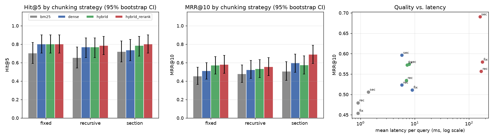
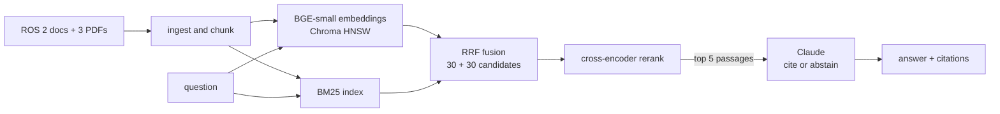
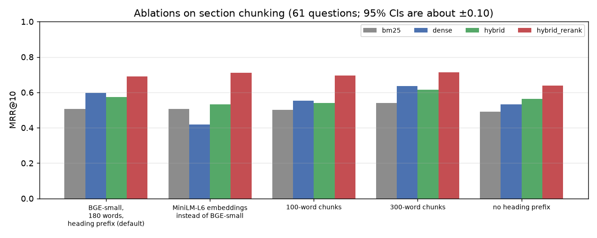
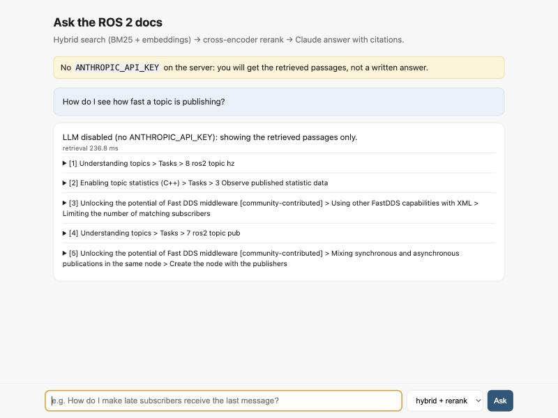

<div align="center">

# Ask the ROS 2 Docs: a RAG Pipeline

Question answering over the ROS 2 documentation and three ROS 2 papers: BM25 + dense hybrid search in Chroma, cross-encoder reranking, and Claude answers with numbered citations. Retrieval choices are scored on a hand-built question set.

[](https://github.com/haroonkhan02/robotics-docs-rag/actions/workflows/ci.yml)




<sub>61 questions, 3 chunking strategies x 4 retrieval modes. Error bars are 95 % bootstrap intervals over questions.</sub>

</div>

## What it does

- Ingests 296 ROS 2 doc pages (reStructuredText, CC BY 4.0) with my own parser that keeps heading paths and code blocks, plus three arXiv papers page by page.
- Compares three chunkers (fixed windows, recursive, section-aware with a heading prefix) and four retrieval modes (BM25, dense, reciprocal-rank fusion, fusion plus reranking).
- Answers with Claude from the top five passages, citing every sentence with `[n]` or abstaining. This requires an Anthropic API key; without one the API, CLI and chat UI show the ranked passages instead.
- Ships a FastAPI backend (`/search`, `/ask`, `/health`), a one-page chat UI, a CLI and a Dockerfile.



## Results

The evaluation set is 61 hand-written answerable questions (CLI, concepts, how-to, project, papers) plus 5 unanswerable ones. A chunk counts as relevant if it comes from a gold document and contains an answer phrase, so every chunker is scored on equal terms. `rag-check-eval` verifies each phrase exists in the parsed corpus (ros2_documentation at commit `0ea463a2`, 299 documents, 311,583 words). Raw per-question results are in `reports/retrieval/results_*.json`.

### Chunking x retrieval (selected rows)

| Chunking | Retrieval | Hit@1 | Hit@5 | Hit@10 | MRR@10 | ms/query |
|---|---|---|---|---|---|---|
| fixed (180 words) | BM25 | 0.279 | 0.705 | 0.770 | 0.454 | 1 |
| fixed | hybrid + rerank | 0.426 | 0.803 | 0.885 | 0.579 | 176 |
| section + heading prefix | dense | 0.459 | 0.738 | 0.820 | 0.596 | 6 |
| section + heading prefix | hybrid (RRF) | 0.426 | 0.787 | 0.902 | 0.574 | 8 |
| **section + heading prefix** | **hybrid + rerank (default)** | **0.590** | **0.803** | 0.885 | **0.690** | 159 |

Hit@k is the share of questions with a relevant chunk in the top k, and latency is retrieval only, on an Apple M5. The other seven rows are in the `results_*.json` files.

The reranker is what puts the right passage first: on section chunks it raises Hit@1 from 0.426 to 0.590 and MRR from 0.574 to 0.690 (paired bootstrap p = 0.02), while Hit@5 barely moves, so it reorders candidates already in the list. Section chunking beats fixed windows by 0.111 MRR only with the reranker (p = 0.007); without it no chunker difference is significant. Even the best setup misses 7 of 61 questions in the top 10.

### Ablations (section chunking)

| Variant | Dense MRR@10 | Hybrid + rerank MRR@10 | p vs default |
|---|---|---|---|
| **Default: BGE-small, 180 words, heading prefix** | 0.596 | **0.690** | n/a |
| MiniLM-L6 embeddings | 0.417 | 0.711 | 0.11 |
| 100-word chunks | 0.553 | 0.696 | 0.85 |
| 300-word chunks | 0.635 | 0.714 | 0.38 |
| No heading prefix | 0.533 | 0.639 | 0.19 |

The embedding model matters a lot for dense-only search (BGE-small beats MiniLM by 0.18 MRR, p = 0.001), but the gap vanishes under the reranker. The heading prefix is the most useful single trick (+0.05 to +0.06 MRR) but isn't significant at n = 61. Chunk size made no detectable difference; I kept 180 words, chosen before evaluation, rather than tune on the test questions. Full table with confidence intervals: [`reports/retrieval/ablations.md`](reports/retrieval/ablations.md).

<p align="center"></p>

### Failure analysis

I read the top chunks for the 14 questions the default setup misses in its top 3. The recurring patterns:

| Pattern | Example |
|---|---|
| Problem and solution in neighbouring chunks | The top chunk describes IP-fragment stalls; the `net.ipv4.ipfrag_time` fix starts the next paragraph. |
| Number buried in a flattened PDF table | "37.4 miles" appears in the abstract and in a table `pypdf` flattens into a row of numbers. |
| Vocabulary gap | "What replaces ROS 1 latched topics?" is answered by one sentence in the QoS page. |
| Overview outranks the page it links to | The DDS overview beats the linked page that has the `RMW_IMPLEMENTATION` answer. |

### Limitations

- 61 questions give 95 % intervals of about ±0.10 on MRR, so only large differences are detectable, and p-values aren't corrected for multiple comparisons.
- I wrote the questions after reading the docs, so they favour facts stated clearly in one place. Real questions are messier and more often multi-hop.
- Answer-level metrics (faithfulness, citation accuracy, abstention) come from `rag-eval-answers`, which uses Claude as a judge and needs an Anthropic API key. It is implemented and unit-tested with a mocked client but has not been run, so no answer-quality number is reported.
- English only; PDF tables are flattened.

## Repository structure

```text
robotics-docs-rag/
├── configs/default.yaml          # pipeline settings
├── eval/questions.jsonl          # 61 answerable + 5 unanswerable questions
├── src/roborag/
│   ├── download.py, ingest.py    # pinned docs snapshot, RST parser, PDF pages
│   ├── chunking.py               # fixed / recursive / section chunkers
│   ├── models.py, store.py       # bi-encoder, cross-encoder, Chroma collection
│   ├── retrieval.py, index.py    # BM25, dense, RRF, reranking, index build
│   ├── generate.py, ask.py       # Claude prompt, citations, abstention, CLI
│   ├── api.py, static/           # FastAPI and chat UI
│   ├── evalset.py, metrics.py    # eval-set check, Hit@k / MRR / nDCG / bootstrap
│   └── evaluate_retrieval.py, evaluate_answers.py, ablations.py
├── scripts/run_ablations.sh
├── reports/retrieval/            # results, tables, figures
├── tests/                        # 47 tests: synthetic corpus, mocked Claude
├── Dockerfile
└── .github/workflows/ci.yml      # lint + tests on 3.10-3.12, docker build
```

## Getting started

```bash
git clone https://github.com/haroonkhan02/robotics-docs-rag.git && cd robotics-docs-rag
uv venv --python 3.12 && source .venv/bin/activate
uv pip install -e ".[dev]"

rag-download                  # ROS 2 docs (5 MB) and 3 papers (25 MB) into data/
rag-index --strategy all      # ~1 min on an M5
rag-check-eval
rag-eval-retrieval            # the grid above -> reports/retrieval/
./scripts/run_ablations.sh && python -m roborag.ablations

cp .env.example .env          # add ANTHROPIC_API_KEY for generated answers
rag-ask "How do I make late-joining subscribers receive the last message?"
rag-serve                     # http://127.0.0.1:8000, /docs for the API
rag-eval-answers              # LLM-judged answer quality (~132 API calls)
```

Docker (CPU, builds the index on first start):

```bash
docker build -t robotics-docs-rag .
docker run -p 8000:8000 --env-file .env -v rag-data:/app/data -v rag-models:/app/models robotics-docs-rag
```

<p align="center"></p>
<p align="center"><sub>Chat UI without an API key: ranked passages with their section paths. With a key, the answer appears above them with clickable [n] citations.</sub></p>

## Design decisions

| Decision | Why |
|---|---|
| ROS 2 docs (jazzy) at a pinned commit | Open licence, real engineering text, and a reproducible eval: answer phrases are verified against that snapshot. |
| Answer-key relevance instead of chunk-ID labels | Chunk IDs change with every chunking; "gold document plus answer phrase" scores all chunkers identically. |
| Hand-written questions | Questions generated from a chunk reuse its words and flatter BM25. I paraphrased on purpose. |
| Own RST parser instead of Sphinx | Sphinx needs the full doc build; a small parser keeps heading paths and code blocks and is unit-tested. |
| RRF (k = 60) instead of score blending | BM25 scores are unbounded and cosine is in [-1, 1]; ranks need no calibration. |
| Cross-encoder on 30 fused candidates | About 160 ms per query against a multi-second Claude call, and the biggest single gain. |
| Cite every sentence or use a fixed abstain sentence | Faithfulness becomes checkable claim by claim, and abstention is detectable by string match. |
| Works without an API key | Retrieval, UI, CLI and the retrieval evaluation need none, and tests never touch the network. |

## Future work

- Run `rag-eval-answers` with a key and add the faithfulness and citation-accuracy table.
- Parent-document retrieval (return neighbouring chunks) for the problem/solution split.
- Query rewriting or HyDE with Claude for vocabulary-gap questions, measured on the same 61.
- Table-aware PDF parsing, and a larger eval set (~200 questions, multi-hop, second annotator).

## Data and licences

- ROS 2 documentation © Open Robotics and contributors, [CC BY 4.0](https://creativecommons.org/licenses/by/4.0/), downloaded at run time from [ros2/ros2_documentation](https://github.com/ros2/ros2_documentation) and not redistributed.
- Papers (arXiv, indexed locally, not redistributed): Macenski et al., *Robot Operating System 2: Design, Architecture, and Uses In The Wild* (arXiv:2211.07752); *The Marathon 2: A Navigation System* (arXiv:2003.00368); *From the Desks of ROS Maintainers* (arXiv:2307.15236).
- Models: BAAI/bge-small-en-v1.5 (MIT), cross-encoder/ms-marco-MiniLM-L-6-v2 and all-MiniLM-L6-v2 (Apache-2.0).

## License

MIT © 2026 Muhammad Haroon Khan. See [LICENSE](LICENSE).
